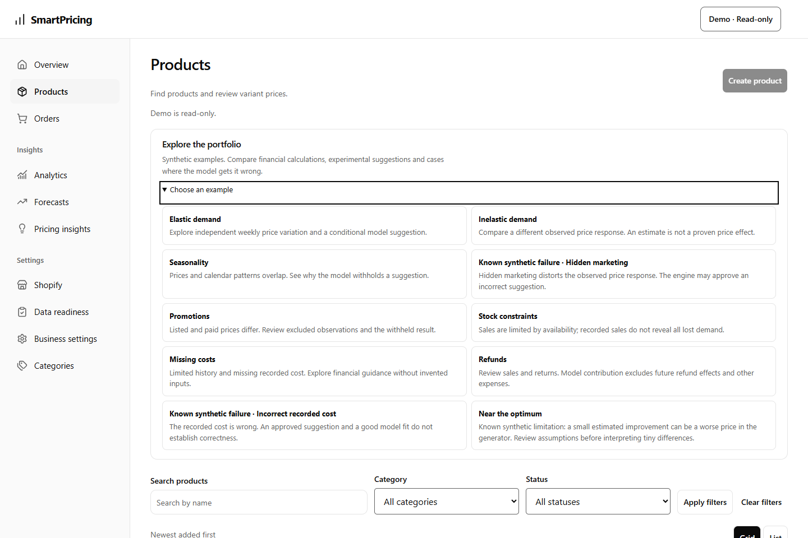
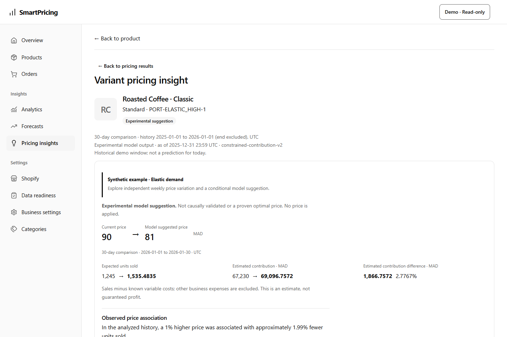

# SmartPricing

A junior full-stack portfolio project using **Java 21, Spring Boot, Angular and PostgreSQL**. It combines an explorable synthetic catalog, immutable sales/refund history, financial what-if calculations and explicitly experimental pricing insights.

**MODEL NOT CAUSALLY VALIDATED.** An approved statistical suggestion can be wrong. Known synthetic failures are deliberately visible; no prices are applied automatically. This project demonstrates engineering and honest evaluation, not a commercial SaaS launch.



## Try it locally — Windows PowerShell

Verified toolchain: JDK 21.0.11, Node 24.22.1 / npm 11.19.1, Docker Desktop with Linux containers. Maven wrapper 3.9.11; Spring Boot 3.5.16; Angular 22.2.6 / TypeScript 6.0.x; PostgreSQL 17.7-alpine. Initial dependency/image downloads require network access. Other operating systems have not been verified.

From this repository root, with Docker Desktop running:

```powershell
$env:JAVA_HOME = 'C:/Program Files/Java/jdk-21.0.11' # adapt to your JDK 21
./scripts/portfolio-demo.ps1 init
./scripts/portfolio-demo.ps1 serve
```

In a second terminal:

```powershell
cd frontend
npm.cmd ci
npm.cmd run start:portfolio
```

Open [localhost:4207/products](http://localhost:4207/products). The portfolio is anonymous and read-only. Init explicitly seeds its own database on 5437; backend is 8087. Serve does not seed. No default administrator/customer identity is created. Keep generated local environment files private. Reset requires the separate guarded command and explicit confirmation; it is unnecessary for browsing.

## A five-minute review

1. **Explore the portfolio → Choose an example → Elastic demand.** Open the product and compare its recorded price/cost with an explicitly assumed what-if scenario in Pricing guidance.
2. **View pricing evidence.** Read the model's current → suggested price, expected units and estimated contribution. Contribution means sales minus known variable costs, excluding other expenses. Historical forecasts display their actual dates, not the coming month today.
3. Open **Hidden marketing** or **Incorrect recorded cost**. The approved result carries a known-failure warning: statistical fit does not establish causality or verify costs.
4. Open **Missing costs** or a withheld insight. Missing inputs remain unavailable, rather than turning into invented zero profit or a forced recommendation.
5. Inspect Analytics, Forecasting and Data readiness; technical evidence stays expandable.



The immutable portfolio has 30 variants, 9,863 orders, 54 refunds and 15 approved / 15 withheld engine outcomes. **15 approvals do not mean 15 correct decisions.** Broader research still found unsafe TEST 65/260 and CHALLENGE 41/156, with hidden causal interval coverage 0/20. See [actual evaluations and known failures](docs/demo/portfolio-evaluation.md) and [canonical research](docs/pricing-research/milestone-11-13-results.md).

## Engineering choices

- One modular Spring Boot application: catalog, append-only finance/history, analytics, forecasting, constrained optimization, financial guidance, auth and read-only Shopify import. JPA handles catalog entities; prepared JDBC queries make financial aggregations explicit. Flyway V1–V7 and database constraints preserve history.
- Angular lazy routes, typed API services, compact Zard/Tailwind UI and black charts. Financial assumptions are separate from observational model estimates; ECharts loads lazily.
- BCrypt administrator sessions, CSRF protection, explicit CORS allowlists, encrypted OAuth tokens and guarded demo database identity. Frontend labels never grant server permissions.
- A separate SaaS business mode supports plan/subscriber arithmetic: yearly cash is not monthly recurring revenue. It has no validated price-response model or live billing integration.

Tradeoffs: a modular monolith is easier to run and explain than microservices; SQL aggregation is explicit but needs maintained query tests; immutable records favor traceability over destructive edits; strict model gates withhold weak evidence but cannot establish causal truth. See the [architecture and quality audit](docs/milestone-12-architecture-and-quality-audit.md).

## Verify

With Java 21, Docker and installed frontend dependencies:

```powershell
cd backend
./mvnw.cmd verify
cd ..
npm.cmd test --prefix frontend -- --watch=false
./frontend/node_modules/.bin/tsc.cmd --noEmit -p frontend/tsconfig.app.json
npm.cmd run build --prefix frontend
```

[Final verification](docs/milestone-12-verification.md) records exact local results, limitations and evidence. There is no CI workflow or claimed hosted CI run. Docker is required for PostgreSQL integration tests. [Interview notes](docs/portfolio-interview-notes.md) explain the design and defensible scope.

## Other installations and documentation

|Installation|Database / API / frontend|Guide|
|---|---|---|
|Portfolio, synthetic read-only|5437 / 8087 / 4207|[Walkthrough and reproducibility](docs/demo/README.md)|
|Normal commerce, authenticated|5433 / 8080 / 4200|[Local setup](docs/local-setup.md)|
|Original research demo, read-only|5434 / 8081 / 4201|[Legacy fixture](docs/demo-data.md)|
|Separate SaaS, authenticated|5435 / 8082 / 4202|[Subscription setup](docs/subscription-setup.md)|

These installations have separate databases/profiles; there is no runtime business-mode toggle. Evaluation saving is an explicit authenticated, CSRF-protected action in normal mode. Demo browsing never saves evaluations or edits prices. See [merchant guide](docs/merchant-workflow.md), [Shopify setup](docs/shopify-connection.md) and [research index](docs/pricing-research/milestone-11-13-results.md).

## Release status and attribution

Locally verified as a CV portfolio; independent merchant usability, live Shopify OAuth/sync, live billing, fresh dependency vulnerability advisories and unsupported environments remain **NOT VERIFIED**. This is not a production security certification.

**No root project license has been selected.** Before public publication, the owner must choose the repository visibility and a license appropriate to their rights. This README grants no new reuse rights. Source-owned Zard components retain their [MIT license](frontend/src/app/shared/ZARD-LICENSE) and [provenance](frontend/src/app/shared/zard-provenance.json); dependencies retain their upstream licenses, and the production build emits `3rdpartylicenses.txt`. Product illustrations are repository SVG assets; demo commerce records are synthetic. No push or deployment was performed for final verification.
