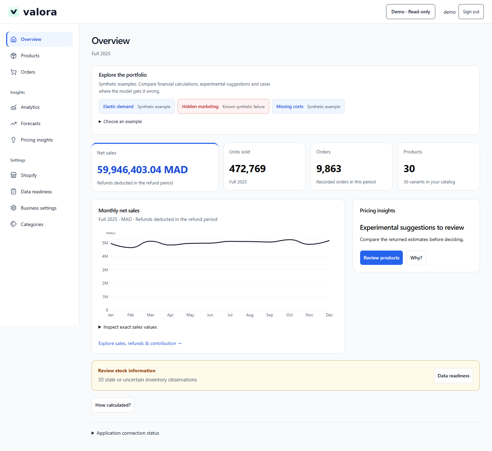
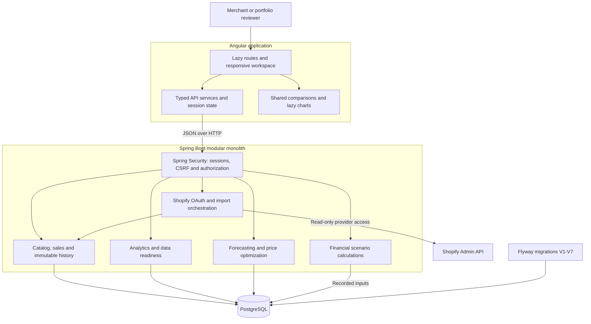
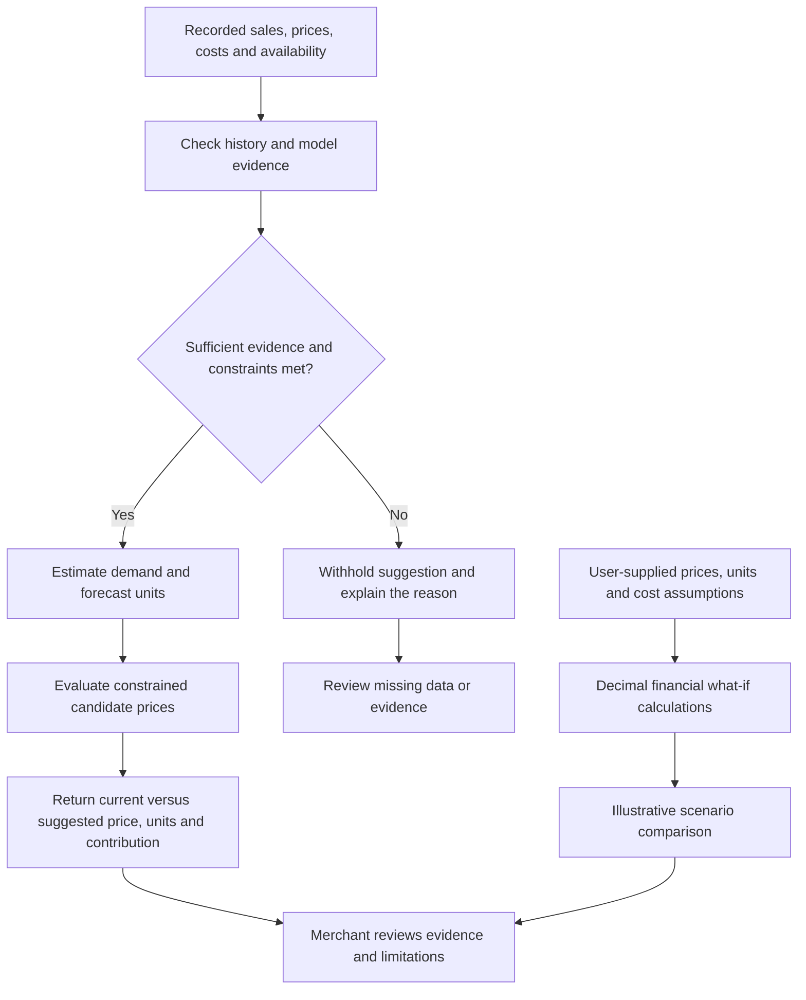
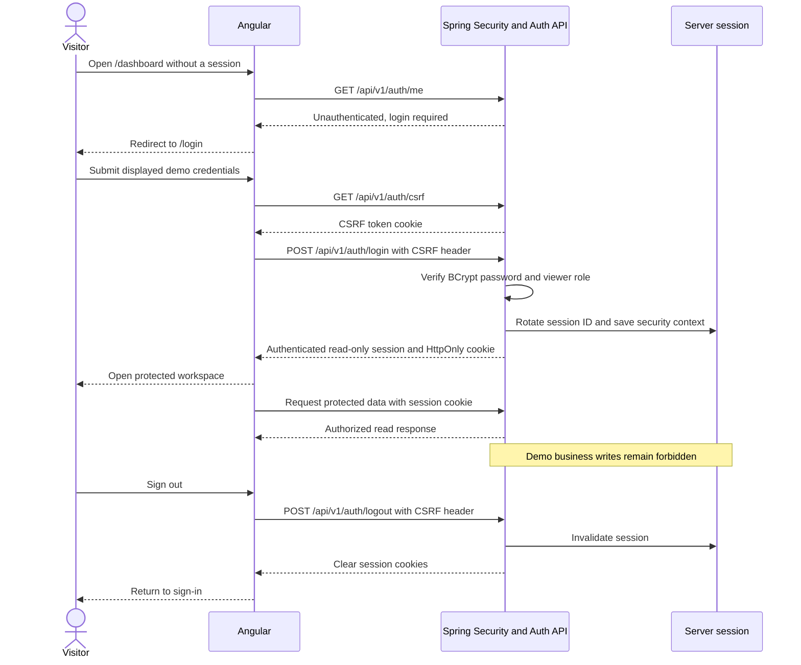

# Valora — Pricing Intelligence

**Understand store performance. Compare price scenarios. Know when the evidence is too weak.**

Valora is a full-stack portfolio application for exploring sales, demand forecasts and pricing decisions. It connects an Angular workspace to a Spring Boot API and PostgreSQL, with immutable financial history, real session authentication and a reproducible synthetic store.

Built to demonstrate end-to-end product development: domain modeling, secured APIs, database migrations, analytical calculations, responsive interfaces and integration testing.

[Quick start](#quick-start) · [Architecture](#architecture) · [Demo walkthrough](#a-five-minute-walkthrough) · [Testing](#testing-and-verification) · [Documentation](#documentation)



*The dashboard above uses synthetic data. Valora was previously named SmartPricing; backend package names and historical verification documents retain that name.*

## What you can do

| Area | Merchant experience |
| --- | --- |
| **Dashboard & analytics** | Review net sales, orders, refunds and contribution, with known-cost coverage visible. |
| **Product catalog** | Search products, inspect variants and follow price, cost and stock history. |
| **Pricing guidance** | Compare current and candidate prices using explicit volume and cost assumptions. |
| **Pricing insights** | Review experimental price suggestions, expected units, estimated contribution and the evidence behind each result. |
| **Demand forecasting** | Explore 7-, 14- or 30-day forecasts, observed sales and supported price-sensitivity estimates. |
| **Data readiness** | Find prioritized gaps in sales, cost or inventory history and the next useful action. |
| **Shopify integration** | Configure OAuth and explicit, read-only data imports in a normal installation. Live provider behavior remains unverified. |
| **Separate SaaS mode** | Explore plan/subscriber accounting and monthly or annual financial scenarios in a dedicated installation. |

**Pricing estimates are experimental.** Historical associations do not establish a causal price effect, and model approval does not prove a suggestion is correct. Valora never applies prices automatically. Estimated contribution means sales minus known variable costs; it excludes other business expenses.

## Quick start

### Prerequisites

The verified local environment uses **Windows PowerShell**, **JDK 21**, **Node.js 24**, **npm 11** and **Docker Desktop with Linux containers**. Maven is included through the wrapper. Initial setup needs network access to download dependencies and container images.

### 1. Clone and initialize the isolated demo

```powershell
git clone https://github.com/iiMedR/valora-pricing-intelligence.git
cd valora-pricing-intelligence

$env:JAVA_HOME = 'C:/Program Files/Java/jdk-21.0.11' # adjust to your JDK 21
./scripts/portfolio-demo.ps1 init
```

Initialization creates a dedicated PostgreSQL instance and reproducible synthetic history. The first seed can take several minutes. Generated database credentials stay in Git-ignored local files.

### 2. Start the API

```powershell
./scripts/portfolio-demo.ps1 serve
```

### 3. Start the frontend in another terminal

```powershell
cd valora-pricing-intelligence/frontend # from the directory containing your clone
npm.cmd ci
npm.cmd run start:portfolio
```

If your terminal is already in the repository root, use `cd frontend` instead.

Open **[http://localhost:4207/](http://localhost:4207/)**.

| Entry point | Purpose |
| --- | --- |
| `/` | Public product landing page |
| `/login` | Sign-in page with visible public demo credentials |
| `/dashboard` | Authenticated overview |
| `/products` | Authenticated catalog and product detail |

### Public demo account

| Account name | Password |
| --- | --- |
| `demo` | `ValoraDemo2026!` |

These credentials are intentionally public and work **only in the isolated portfolio demo**. Choose **Use demo credentials**, then **Sign in**. This creates a real backend session; route guards alone do not grant access. The viewer cannot edit records, save evaluations, import data or connect providers. Normal administrator credentials are provisioned separately and are never shown publicly.

Ordinary `serve` does not reseed data. Reset is a separate guarded command; it is unnecessary for exploring the app. See the [demo guide](docs/demo/README.md) for reproducibility and reset behavior.

## Architecture

### System overview

Valora is a **modular monolith**: one Spring Boot deployment with domain packages, rather than separate services. The diagram below shows a commerce installation; demo and SaaS installations use separate profiles and databases.



JPA handles catalog persistence; prepared JDBC queries support historical and financial aggregations. Services own validation and transaction boundaries. Append-only history and database constraints preserve recorded sales, refunds and time-dependent observations.

Read the [architecture and quality audit](docs/milestone-12-architecture-and-quality-audit.md) for the implementation review and tradeoffs. That document is a historical milestone snapshot; the current authentication flow is documented below.

### From history to a pricing decision

Financial scenarios and model suggestions are separate workflows. A what-if scenario calculates the result of assumptions supplied by the user; it does not silently turn those assumptions into a forecast.



All comparisons shown by the model workflow come from the API. Weak evidence produces a withheld result rather than an invented price or zero-valued estimate. Historical demo forecasts display their actual forecast dates, rather than implying they predict the coming month today.

### Authentication and read-only demo access



The API enforces authorization independently of Angular. Login/logout use CSRF protection; session cookies are HttpOnly and SameSite=Lax. Normal installations use a separately provisioned administrator. The legacy research demo retains its original anonymous read-only behavior. See [authentication](docs/authentication.md) for cookie, CORS and configuration details.

## Technology stack

| Layer | Implementation |
| --- | --- |
| Frontend | Angular 22, TypeScript 6, signals, lazy routes, typed HTTP services |
| UI & charts | Zard UI, Tailwind CSS 4, ECharts 6 via ngx-echarts |
| Backend | Java 21, Spring Boot 3.5, Spring MVC, Validation, Data JPA and JDBC |
| Security | Spring Security, BCrypt, server sessions, CSRF and explicit CORS allowlists |
| Persistence | PostgreSQL 17, Flyway migrations V1–V7 |
| Testing | JUnit, Spring Boot Test, MockMvc, Testcontainers, Vitest and Playwright |
| Local infrastructure | Docker Compose, Maven wrapper and PowerShell launch scripts |

## A five-minute walkthrough

1. **Sign in and open the dashboard.** Review the synthetic store's sales and monthly trend.
2. **Choose an example → Elastic demand.** Open a product and compare recorded prices/costs with an explicitly assumed financial scenario.
3. **View pricing evidence.** Compare current → suggested price, expected units and estimated contribution. Expand the reasoning when needed.
4. **Inspect Hidden marketing or Incorrect recorded cost.** These deliberately expose cases where the model approves a misleading result.
5. **Open Missing costs or Data readiness.** Find a withheld reason and the next useful review action.

The portfolio fixture contains **30 variants, 9,863 orders and 54 refunds**, with **15 approved and 15 withheld engine outcomes**. Approval is not proof of correctness. The unchanged legacy fixture withholds all 30 variants. See [portfolio evaluations](docs/demo/portfolio-evaluation.md) for the actual scenarios.

## Project structure

```text
valora-pricing-intelligence/
├── backend/
│   └── src/
│       ├── main/java/com/smartpricing/
│       │   ├── auth/                    # Sessions and access control
│       │   ├── catalog/                 # Products, variants and settings
│       │   ├── sales/ & history/        # Orders, refunds and historical records
│       │   ├── analytics/ & onboarding/ # Reports and data readiness
│       │   ├── forecasting/             # Demand models and diagnostics
│       │   ├── optimization/ & guidance/# Model comparisons and financial scenarios
│       │   ├── shopify/                 # OAuth and read-only synchronization
│       │   ├── subscription/            # Separate SaaS business mode
│       │   └── demo/                    # Guarded deterministic datasets
│       ├── main/resources/db/migration/ # Versioned schema
│       └── test/                        # Unit and integration tests
├── frontend/src/app/
│   ├── core/                           # Sessions, guards and environment context
│   ├── features/                       # Landing, catalog and merchant workflows
│   └── shared/                         # UI components, charts and explanations
├── infra/                              # Isolated Docker Compose configurations
├── scripts/                            # Local setup and guarded demo commands
├── research/                           # Reproducible model validation tooling
└── docs/                               # Guides, research and verification evidence
```

### Installation boundaries

| Installation | Database / API / frontend ports | Access |
| --- | --- | --- |
| Portfolio synthetic store | `5437` / `8087` / `4207` | Public credentials, authenticated read-only viewer |
| Normal commerce | `5433` / `8080` / `4200` | Separately provisioned administrator |
| Legacy research demo | `5434` / `8081` / `4201` | Anonymous, read-only |
| Separate SaaS installation | `5435` / `8082` / `4202` | Authenticated, dedicated business mode |

Each installation uses its own database and profile configuration. There is no runtime switch that mixes commerce and SaaS records. Demo identity checks protect normal databases from synthetic seeding or reset commands.

## Testing and verification

With Java 21, Docker and frontend dependencies installed, run from the repository root:

```powershell
Push-Location backend
./mvnw.cmd verify
Pop-Location

npm.cmd test --prefix frontend -- --watch=false
./frontend/node_modules/.bin/tsc.cmd --noEmit -p frontend/tsconfig.app.json
npm.cmd run build --prefix frontend
```

Latest local verification on **14 November 2026**:

| Check | Result |
| --- | --- |
| Backend unit tests | 128 passed |
| PostgreSQL-backed integration tests | 70 passed |
| Frontend tests | 163 passed |
| TypeScript checks and production build | Passed |
| Landing and login accessibility | No axe WCAG A/AA violations at 375, 768 and 1440 px |
| Demo invariants | Dataset checksums, pricing outputs and migration checksums preserved |

Tests cover financial arithmetic, historical boundaries, idempotent imports, authorization, CSRF, session lifecycle, migrations and model withholding. Browser checks also exercise responsive layouts, protected entry routes and logout. These are recorded local results, not a hosted CI badge or a guarantee of accessibility.

See [current demo-access verification](docs/valora-access-verification.md), [visual verification](docs/milestone-12-1-verification.md) and [final portfolio verification](docs/milestone-12-verification.md). No GitHub Actions workflow is configured.

## Scope and limitations

- **Observational models remain experimental.** Broader research found unsafe outcomes in TEST (65/260) and CHALLENGE (41/156), and hidden causal interval coverage of 0/20. Known failures remain visible. Read the [research results](docs/pricing-research/milestone-11-13-results.md).
- **Contribution is not net profit.** Unknown costs stay unavailable; other business expenses and future refund effects are not automatically accounted for in model comparisons.
- **Stockouts limit interpretation.** Forecasts estimate sales under stated price and availability assumptions, not customers lost during stockouts.
- **SaaS support is financial decision support.** Monthly recurring revenue is distinct from cash collected; there is no validated SaaS price-response model or live billing integration.
- **External and production validation remains open.** Live Shopify OAuth/import behavior, independent merchant usability, fresh dependency advisories and unsupported operating systems have not been verified. No hosted deployment is claimed.

## Documentation

| Guide | Contents |
| --- | --- |
| [Portfolio demo](docs/demo/README.md) | Walkthrough, isolation, reproducibility and reset commands |
| [Merchant workflow](docs/merchant-workflow.md) | How to use the catalog, insights and readiness pages |
| [Architecture review](docs/milestone-12-architecture-and-quality-audit.md) | Module responsibilities, design tradeoffs and historical audit |
| [Authentication](docs/authentication.md) | Sessions, CSRF, demo access and administrator provisioning |
| [Shopify setup](docs/shopify-connection.md) | OAuth configuration, security boundaries and import setup |
| [Normal local setup](docs/local-setup.md) | Authenticated commerce installation |
| [Subscription setup](docs/subscription-setup.md) | Separate SaaS mode and accounting semantics |
| [Interview notes](docs/portfolio-interview-notes.md) | Engineering decisions and defensible project scope |
| [Repository history](docs/repository-history.md) | Retrospective import dates and preserved history |

## License and attribution

[MIT](LICENSE) — Mohamed Reda El Ghazouani.

Source-owned Zard components retain their [MIT license](frontend/src/app/shared/ZARD-LICENSE) and [provenance](frontend/src/app/shared/zard-provenance.json). Other dependencies retain their upstream licenses; production builds emit `3rdpartylicenses.txt`. Valora branding was supplied by the project owner, product illustrations are repository SVG assets, and demo commerce records are synthetic.
