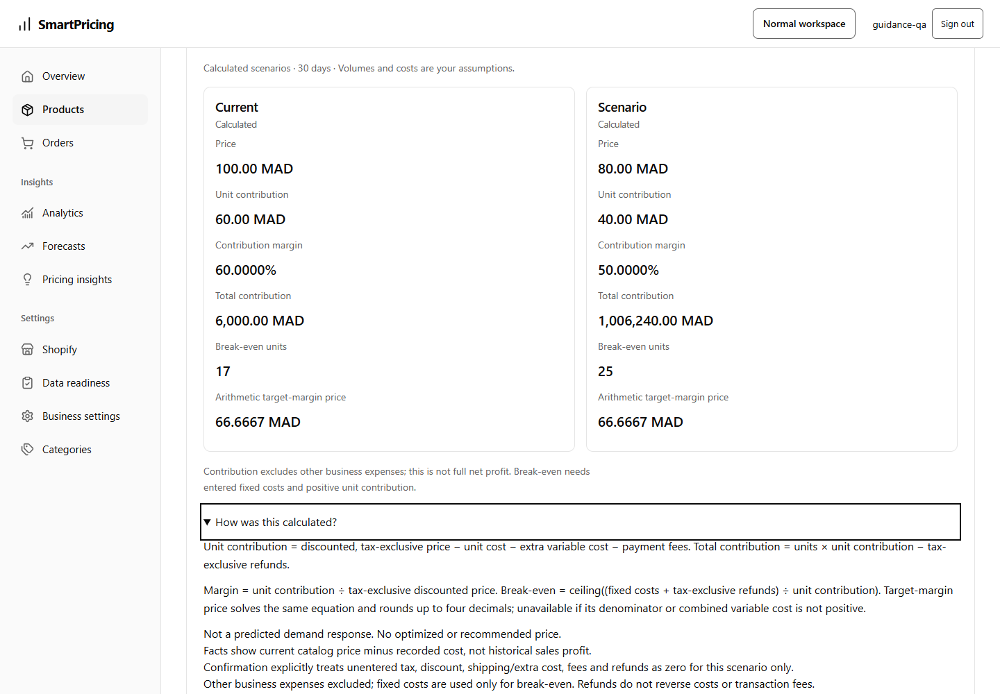

# Merchant workflow

Open the **normal workspace** at http://localhost:4200 for your business records. It requires the existing administrator account for business screens. The **synthetic demo** at http://localhost:4201/products contains30 products and9,466 orders from2025; it is anonymous and read-only. They use separate backends/databases. The compact workspace button opens an explanation and links to switch deliberately; opening the demo never imports its records into your business.

## Overview and navigation (11.6)

Start on **Overview**: the reporting period, actual net sales, units, orders and product count come first. Demo starts at Full 2025; the black chart shows monthly net sales with refunds deducted in their refund period. **How calculated?** retains the exact API amount behind the rounded currency display. Expand **Inspect exact sales values** to select a month or read the keyboard-accessible table.

**Pricing insights** appears beside the chart. In the permanent demo, **No reliable price changes suggested** follows a complete check of all 30 variants. **Why?** explains the evidence and period; **Review products** opens the existing pricing page. A failed/partial check shows progress and Retry rather than a catalog-wide claim. The next stock-information action leads to Data readiness. Normal empty stores retain setup links and do not invent opportunities.

The header's **Demo · Read-only** / **Normal workspace** button explains mode and provides deliberate workspace-switch links. Demo disclosure identifies synthetic historical 2025 records. At small widths, **Open navigation**, then **Products**, takes two interactions. Escape or Close dismisses the drawer and restores focus; explanation dialogs behave the same way. Navigation now names **Products**, **Orders**, **Forecasts** and **Pricing insights** while retaining the same URLs. Existing detailed calculations, diagnostics and evaluations remain available in their prior workflows.

Products show a named link, neutral image fallback and textual status. Images and product-level prices are absent from the current DTO; open **View variants** for actual prices. Order lists show shorter references and currency-formatted amounts; full IDs and original amounts remain in order details. Filters are local time and displayed dates UTC. Data readiness initially shows up to three API-prioritized actions; **Show all next steps** reveals the rest. Fixing an input does not promise a recommendation.

## Find a product and review its variant — 11.7

Open **Products**. Type a name to search, or choose a category/status and select **Apply filters**. **Clear filters** resets the search and returns to the first page. **Grid** and **List** show the same products and preserve your selection in the URL. Use Next/Previous for larger catalogs; each page contains at most20products, newest added first.

A tile or row opens the product. Neutral initials mean no image is available; they are not product photos. **View variants** is intentional: the list API has no reliable product-level price or variant count. The product page gives the actual variant count. Choose **Selected variant** to see that SKU's current catalog price, cost and status. Its URL remembers the selection. **Price limits and exact amounts** preserves the original decimals behind the rounded display. Unknown costs stay unavailable.

**Sales performance** shows only the chosen variant's returned units and net sales for the displayed UTC window. Refunds are deducted in their refund period. A variant sales trend and live stock are not provided by these endpoints; inspect the sales view or dated inventory history rather than infer them from a store chart.

**Pricing insight** states whether the API supports a suggestion. Permanent-demo variants still have no reliable price change. **Why this result?** opens the actual reasons, window, assumptions and optional model/audit detail. A supported price remains an estimate to review, never an automatic price write. **View sales**, **View forecast** and **View pricing evidence** preserve the variant and date context; **Back to product** returns to that selection, and **Back to results** restores catalog filters/view/page.

Normal-mode create/edit/archive forms keep their existing validation, version and confirmation protections. Selection is disabled while editing or saving. Demo controls are disabled with a short read-only explanation. A missing product/variant, failed API or unavailable metric is shown explicitly; Retry re-reads the relevant request without inventing zeros.

## Read the four insight pages

**Pricing insights — “Which prices should I review?”** Search by product/variant name or SKU, or select **Update results**. Choose 30 days (default), 7 or14. **All**, **Actionable**, **Needs evidence** and the optional **Filter status** apply to the current page or loaded results, not the whole catalog. Counts say their scope. Use Next/Previous to browse; filters, page and selection stay in the URL. The × beside search clears the filters.

Select **Review insight** to see that variant's current reference price and supported comparison, or **No reliable price suggestion yet** with its reason. **Why this result?** opens the optional evidence dialog. Expand reasons/identification, costs and calculations, forecast/backtests, or model/audit sections as needed. Escape returns focus to Why; Back to pricing results restores the row. Catalog, sales, forecast and readiness links preserve the available variant/date context.

In authenticated normal mode only, expand **Model, assumptions and saved evaluations** and explicitly select **Save fresh evaluation**. The server re-evaluates the selected inputs and saves an audit snapshot; it never applies a price. Opening the view/dialog does not save or load history automatically. **Load saved evaluations** retrieves historical snapshots, distinct from the current calculated result. Save errors remain visible and are not automatically retried. Closing waits while an explicit save is pending; the result or timeout releases it. Demo has no save action.

Under **Check more variants or see an example**, **Check catalog** checks sequential batches of10, up to100 variants per action. Cancel retains partial results; Retry resumes a failed batch. Continue is explicit beyond the cap. Changing search/dates/horizon clears old results. Only a complete check can say no suggestions exist across all matching variants.

A supported card shows **current price → suggested price**, expected units at both prices, estimated contribution at both prices, and the amount/percentage difference. **Estimated contribution means sales minus known variable costs; other business expenses are excluded.** It is not guaranteed profit. **Why this result?** opens the supporting costs, constraints, evidence and evaluation history. Closing the explanation returns focus to its Why button. No price is applied automatically.

For supported price sensitivity, the explanation translates the estimate into a local 1% relationship. For example, −2 means a 1% higher price was associated with approximately 2% fewer units sold in the analyzed history. Association does not establish a guaranteed causal effect. Where that relationship is unreliable, the app explains why instead of presenting the coefficient as advice. Products without suggestions show their current price, a short reason and **Review what to fix**.

All 30 permanent-demo variants still have no reliable price suggestion. Under **Check more variants or see an example**, open **See a worked pricing example** to learn the comparison separately: hypothetical price 100 → 80, unit cost 40, expected units 100 → 156.25, and 30-day estimated contribution 6,000 → 6,250. It is clearly illustrative, is not your store's recommendation, is excluded from result counts and cannot be saved as an evaluation.

**Analytics — “How is my store doing?”** Read Net sales, Orders and Contribution from sales with known costs first. Cost coverage tells you which share of sales lines has a known historical cost. Read the black sales chart for the selected date window. **More sales metrics and accounting details** contains refunds, gross sales, average order value and the accounting caveats. Expand **Product performance: search, sort and drill down** or **Inventory observations and data quality** when needed. Those sections stay open when their report refreshes.

**Forecasting — “How much might this product sell?”** Search the product cards and choose **View sales forecast**. Read expected units, the price used, and the actual forecast dates; select 7/14/30 days. The result assumes the listed price and availability assumptions hold. It does not estimate customers lost during stockouts. Price sensitivity appears alongside it only when sufficiently supported. Statistical evidence, exact tables and backtests remain expandable. Historical demo forecasts show their historical dates, not a prediction for today.

**Data readiness — “What should I fix next?”** Follow **Your next steps**, ordered by the API's priorities. Each item explains what to review and links to the relevant screen or filtered product list. Connection and last-import status remain visible. **Detailed data checks** contains raw counts, technical status codes, per-variant tables and import controls. Completing missing fields helps evaluation but does not guarantee a suggestion.

## Workspace navigation

The redesigned **Overview** opens with your actual reporting figures and next actions. Normal mode shows setup guidance when the catalog is empty. Demo mode opens its historical Full 2025 records: it does not show a fictitious connected Shopify store, completed merchant review, growth percentage or readiness score. Net sales deduct merchandise refunds in their refund period. The currency label applies to the displayed exact decimal amount.

Desktop navigation now groups **Workspace**, **Insights & decisions**, and **Integrations & settings**. **Catalog** opens the existing Products route; **Data readiness** opens Onboarding; **Shopify** opens Store connection; **Recommendations** opens the existing pricing evaluation workflow. Detail URLs remain unchanged. Saved evaluations remain within each variant's recommendation view.

Overview and Analytics use gradient area charts based on actual API buckets. Hover or tap a chart to inspect a period. **Inspect exact sales values** opens a keyboard-accessible period selector and exact-value table; it remains the authoritative alternative to approximate plotted coordinates. Analytics date presets and date/granularity filters request real periods. Help buttons open with click/Enter and close with Escape. The smaller system typography preserves readable mobile inputs and large interaction targets.

Desktop has a workflow rail. Tablet/mobile has an **Open navigation** button, with expanded state announced. Use Tab/Enter to navigate; Escape closes the disclosure and returns focus to its button. Following a link focuses the new page content. A skip link bypasses navigation. The mode label and account state remain visible on nested screens.

1. **Store connection**: inspect authorization and explicitly start/resume/retry existing sync operations when allowed. Authorization is separate from successful import. Demo connection controls are disabled.
2. **Onboarding**: review coverage and the prioritized checklist. Follow links for missing costs, stale stock or incomplete dated observations. Imported, analytically observable, forecast-evaluable and optimization-eligible are separate decisions.
3. **Products / Categories / Orders**: inspect catalog and immutable history. Normal merchant edits use existing validated forms and optimistic versions. Archived records retain their history. Only unused categories can be deleted.
4. **Analytics**: examine observed transactions, refund-period adjustments and known-cost contribution. Unknown historical costs are not zero.
5. **Demand forecasting**: review availability-conditional observed-sales forecasts and choose 7, 14 or 30 days. Open **How this estimate works** for association estimates, fit diagnostics and exclusions, and the validation disclosure for chronological backtests. These are not recovered latent demand or proof of a causal price effect.
6. **Pricing recommendations**: inspect eligibility and all withholding reasons. A conditional suggestion is displayed only when the existing backend gates pass. No price is applied automatically.

## Historical dates and the demo

Demo insights initially select **Full 2025** (2025-01-01 through2026-01-01 exclusive UTC), matching the existing seed. Normal mode retains current UTC defaults. All date inputs remain editable; date presets issue real API queries rather than inserting or fabricating data. Orders/history retain explicitly labeled local-time entry and UTC display conventions. If a window has no records, change the filters; do not reseed/reset to make a chart appear.

## Safe editing and confirmation

Merchant editors highlight invalid fields and focus the first invalid input on submission. Fields and duplicate submissions are disabled while a save is in progress. Errors retain values. Successful saves clear the unsaved marker. Leaving/reloading a dirty editor asks before discarding; leaving during a pending save warns that the server may still finish it. Native browser unload confirmation also protects dirty forms when leaving the app. Explicit Cancel buttons intentionally dismiss an edit.

Archive/delete confirmation dialogs explain consequences, start on Cancel, wrap Tab/Shift+Tab, cancel with Escape and restore the triggering focus where possible. Archiving products/variants does not erase order or observation history. A stale-version conflict keeps your edits so you can review before an explicitly confirmed reload. History-type changes ask before clearing an unfinished observation. Session expiry always permits removal of protected content and sign-in; unsafe requests are not automatically retried.

## Evaluation snapshots

In normal authenticated mode, **Save fresh evaluation** re-evaluates the selected dates/horizon and saves that fresh conclusion through the existing CSRF-protected endpoint. It saves metadata only. The saved status can differ from a previously displayed result if inputs changed. Identical inputs are deduplicated by the backend. Load saved evaluations to inspect bounded pages; no record is created merely by viewing diagnostics/history.

Saved conclusions are append-only evidence of what the model concluded, not measured sales/profit outcomes. Realized uplift is not measured. Demo has no save affordance and the backend denies writes. Uncertainty intervals remain unavailable/uncalibrated. The permanent seasonal example remains weakly identified and all 30 permanent-demo variants withhold recommendations; this is a limitation to understand, not a reason to relax the gates.

## SaaS subscription workspace (11.9)

E-commerce installations retain Products, Orders, Analytics, Forecasts, Pricing insights, Shopify and existing data readiness. SaaS is a distinct **fresh installation**, not a runtime switch or a relabeled product catalog. See [SaaS setup](subscription-setup.md).

In a SaaS installation, use **Settings & data** to preview and explicitly record a plan price, subscription lifecycle and actual paid evidence. Nothing is sent to a billing provider. **Overview** answers how recorded recurring run rate and paid-subscription counts changed. Use **Plans** to search/sort, inspect immutable price versions and load a 30-day subscriber trend; new versions do not automatically migrate subscribers. **Subscriptions** lists opaque IDs and effective/scheduled state without customer PII. **Revenue & retention** distinguishes cash, run rate and beginning-population churn, with exact table alternatives and definitions on demand.

All reports clearly say partial manual history. Missing records can change any result. A scheduled cancellation does not count as ended before its effective date. Trials and unsupported states must not be entered as paid records. **Pricing insights** shows Needs evidence and explains the absence of a validated SaaS model; there is no suggested plan price or automatic application. Adding arbitrary records does not establish causality or guarantee recommendations. CSV, live billing providers, customer/logo churn and complete cohort retention are unavailable in this bounded slice.

## Finding and returning to work (11.10)

In SaaS **Plans**, search and choose **Update**, then **Review plan**. Current plan price and billing interval appear first. **Price history** distinguishes historical/scheduled versions; **Source references and exact prices** contains the IDs needed for manual entry. **Back to plans**, browser Back/forward and reload retain the applied search, dates, sort and page. The source line always identifies partial manual coverage. Changing a control does not silently change the meaning of the current report: choose Update to apply it.

In **Settings & data**, choose a human-readable record type, enter the supplied source references, validate/preview, then explicitly record or return to editing. **Clear entry** and navigation away from a dirty draft ask before discarding. On session expiry the draft and protected reports clear. Re-entering an identical source record remains an idempotent replay, never a second charge. Rounded main figures have unrounded values in optional inspection. In e-commerce, use **How to read this demo** for a concise abstention explanation, and Shopify status to see that live store synchronization remains unverified. No price is applied automatically in either mode.

Independent participant validation has not been performed. The [novice task script and blank results sheet](ux/milestone-11-10-usability-script.md) are ready for future merchant/founder sessions.

## Pricing guidance and your assumptions (11.12)

From **Products**, open a product and select its variant. Read its separate **Pricing insight** status first. **Pricing guidance** jumps to known catalog inputs and an ephemeral scenario comparison. A model suggestion, when eligible, remains separate; guidance does not turn an abstention into a recommendation.

1. Read listed price, recorded unit cost, price-minus-recorded-cost and margin before excluded expenses. These are current catalog arithmetic, not historical profit. Missing cost says unavailable; **Add or review unit cost** opens this variant's dated history. In normal mode choose **Unit costs** and record an authoritative current change with an open end/version if you mean to update current cost, or use the existing variant editor. A historical-only cost does not silently fill current catalog facts. Demo records remain read-only.
2. Enter a candidate price and **separate assumed units at current and candidate prices**. Choose the assumed1–366day period. No volume is filled from a model, and changing price does not automatically change units.
3. Optionally expand **Costs, fees and other assumptions**. Supply an assumed cost override, extra variable unit costs (including shipping if relevant), included tax, discount, payment fee, refund amount, fixed period costs and/or target margin. A cost override stays an assumption; it does not replace the recorded cost.
4. Explicitly confirm that unentered extras/taxes/discounts/fees/refunds are assumed zero for this scenario. Otherwise no comparison is calculated. Read **Current / Scenario**, both marked **Calculated**, with contribution and margin. Totals require supplied units. Break-even also needs fixed costs and positive unit contribution. A target-margin price is an arithmetic threshold, not a demand-validated suggested price.
5. Open **How was this calculated?** for equations, exclusions, evidence labels and version. Changes recalculate through a read-only API after a short debounce. Reset clears assumptions. No prices, orders, evaluations or scenario records are saved or applied; selection/session changes clear the draft. Existing explicit **Save fresh evaluation** still belongs only to optimizer evidence.

**Not a predicted demand response.** Contribution means sales minus the modeled known/assumed variable costs; other business expenses are excluded. It is not full net profit. Refund assumptions do not recover stock costs or reverse fees. If a request fails, edit/retry it; stale comparisons disappear instead of remaining under new inputs.

The screenshot below is an **isolated synthetic QA example**, not your store or a permanent-demo recommendation: listed100/cost40, candidate80, separately assumed units100/156.25 over30days. Contributions are6000/6250. Fixed costs1000 yield break-even17/25; a40% target margin gives an arithmetic threshold66.6667. These volumes are explicit assumptions, not a learned elasticity or promised uplift.

[Mobile walkthrough screenshot](ux/screenshots/milestone-11-12/normal-guidance-375.png) · [Missing-cost state](ux/screenshots/milestone-11-12/missing-cost.png) · [Exact definitions and limits](pricing-research/progressive-pricing-guidance.md).

Keyboard: activate the catalog and Pricing guidance links with Enter, Tab through inputs, Enter to expand cost/formula disclosures and Space to confirm assumptions. The30permanent-demo variants still withhold optimized prices; their known catalog inputs can support labeled arithmetic without repairing missing historical evidence. Independent merchant comprehension remains NOT VERIFIED. Live Shopify remains LIVE_SHOPIFY_NOT_VERIFIED; no live experiment or price application is included.
