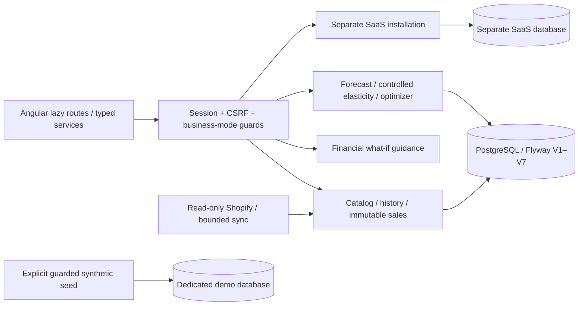

# Milestone 12 architecture and quality audit

2026-11-14; baseline0657cd5, audit commit c781eac. Scope: bounded source/configuration review and local integration evidence, not a penetration test or production readiness certification.

## Responsibilities and data flow

Backend packages under backend/src/main/java/com/smartpricing:

|Boundary|Responsibility / review evidence|
|---|---|
|auth, config, business|One-time administrator, BCrypt12, rotated server sessions/CSRF, explicit origin allowlist; immutable installation business mode. SecurityConfiguration, AuthController, AccountService, WebConfiguration.|
|catalog, history, sales|JPA catalog entities; prepared JDBC history/financial queries, transaction boundaries and database period constraints. SalesService snapshots historical verified costs, uses source/external-key locks plus fingerprints and limits refunds.|
|analytics, onboarding|Recorded net sales, known-cost contribution/coverage, prioritized input fixes; readiness never grants model eligibility.|
|forecasting, optimization|Observational controls, fit/identification/backtests, constrained contribution comparison, explicit append-only evaluation audit. Experimental output is conditional, not causal truth.|
|guidance|BigDecimal financial arithmetic; separate recorded inputs and explicit assumptions; unknown costs remain unavailable. No demand model or automatic price writes.|
|subscription|Separate installation/database, append-only subscriber events, cash versus monthly-normalized recurring accounting and monthly/yearly guidance.|
|shopify, shopify/sync|Canonical shop allowlist, single-use session-bound OAuth state, HMAC/timestamp checks, AES256-GCM purpose-bound tokens, read-only scopes, bounded transactional/idempotent imports. Live provider behavior remains unverified.|
|demo|Deterministic records, canonical exports, dedicated role/database/marker checks before startup/seed/reset; demos reject normal writes.|
|common|Bounded HTTP, safe errors, audited entities. No exception messages/stack traces exposed by default.|

Frontend overview/products/detail/history/orders/analytics/forecasting/optimization/readiness routes and separate /saas routes use typed services, signals and auth/mode guards. Shared Zard UI, price comparisons, sensitivity explanations, financial guidance and lazy black charts centralize repeated presentation. Catalog checks are sequential/cancellable; session loss clears protected results. API access remains enforced on the server. Public environment identity must be verified before portfolio stories appear. Loading, empty, failure and retry states were rehearsed separately.

Normal5433/8080/4200, legacy5434/8081/4201, portfolio5437/8087/4207, SaaS5435/8082/4202 are separate installations. Portfolio wrapper reuses guarded demo machinery; ordinary serve never seeds. The browser QA uses existing disposable5436 databases and8085/8086, never business-record writes to normal/legacy/portfolio. Flyway validate/replay and exclusive demo identity tests protect boundaries.

## Five prioritized findings and decisions

|Finding|Risk / benefit|Decision|
|---|---|---|
|No root project license|High publication ambiguity; explicit owner choice gives reviewers clear rights.|Document, do not choose a grant on the owner's behalf. Public publication pending choice.|
|README stale schema/audit statements and milestone wall|Medium comprehension risk; a short entry and linked details improve review.|Rewrite with real screenshots, verified Windows commands, V1–V7 and explicit evaluation saving; preserve normal setup in its own guide.|
|Current dependency advisories unavailable offline|Medium unknown exposure; refreshed advisories would improve release confidence.|Report NOT VERIFIED. Offline npm zero entries is not fresh coverage. Maven dependency-tree plugin unavailable offline; no unjustified upgrades.|
|Large historical evidence and compact research scripts|Medium maintenance/navigation cost; deleting them would break reproducibility.|Retain research/oracles/fixtures, link canonical evidence. Add only an optional verifier output path to avoid overwriting historical reports.|
|No CI and no independent/live integration evidence|Medium repeatability/external-validity gap; automated Docker CI and external trials could help.|Keep reproducible local commands; no invented CI run, live compatibility or independent usability claim. Defer separately scoped work.|

No confirmed new core runtime defect found in the reviewed paths. Modular monolith and explicit SQL are reasonable junior-project tradeoffs; avoid repository-wide stylistic rewrites. SQL inputs use bound values; dynamic order/filter fragments are constrained by domain allowlists. Existing tests exercise malformed inputs, concurrency/idempotency and authorization. This is targeted review, not exhaustive proof against injection or every attack path.

## Publishing/configuration checks

.gitignore excludes .env/local files, target/dist/node_modules/logs; tracked environment inventory contains only infra/.env.example. Sensitive key/environment filename history inventory returned no private-key/real-env candidates. Five common credential signatures (private-key header, GitHub, Stripe live, Shopify token, AWS key) matched zero tracked files. This heuristic is not a complete historical secret scan; no dedicated secret scanner was installed. No tracked file exceeds1MB. Local development database defaults are intentional and must never be deployed publicly. Session cookies are HttpOnly/SameSite Lax; secure defaults false for loopback, configurable for HTTPS; no deployment was assessed.

Production build has no emitted .map files and includes3rdpartylicenses.txt; development source maps remain enabled. Root license absent, Zard MIT/provenance retained. No .github workflow exists. Cached clean-source npm ci and production build passed; fresh online dependency resolution and unsupported operating systems remain unverified. No new dependency or data migration is justified by these findings.
