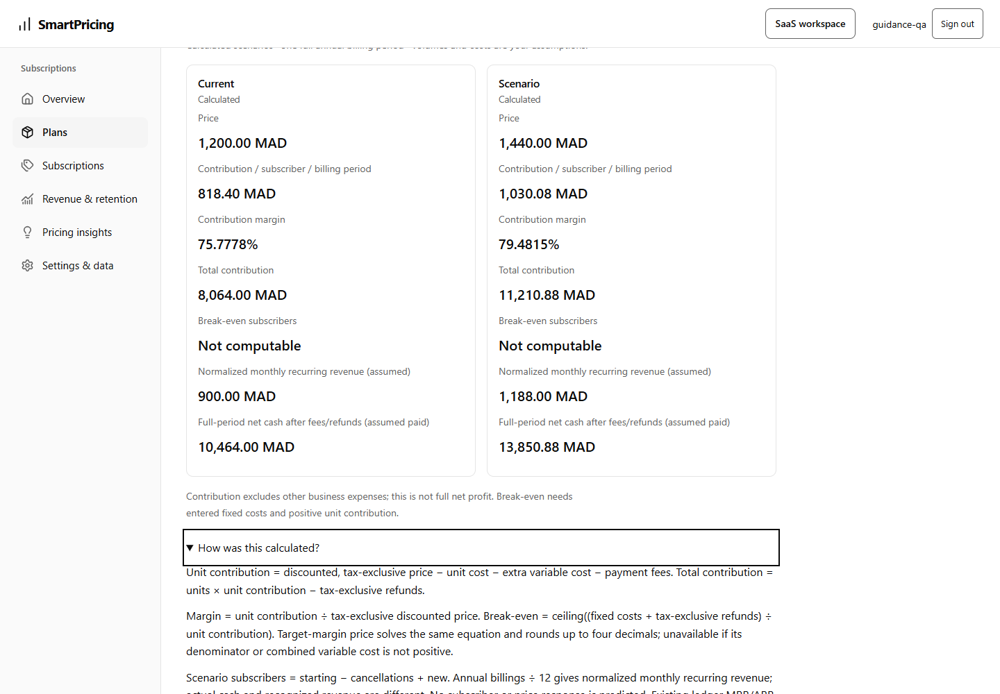

# Set up a SaaS installation

The normal store at ports 5433/8080/4200 and permanent e-commerce demo at 5434/8081/4201 stay e-commerce. A SaaS workspace requires a fresh separate database, selected before its first application startup. This is a second local installation, not a tenant or mode toggle inside an existing populated store.

## Local development

From the repository root in PowerShell, choose a local database password without committing it. Use a free port if 5435 is occupied by an explicitly identified QA instance; stop only that QA instance first, or set SAAS_POSTGRES_PORT consistently for Compose and backend.

```powershell
$env:SAAS_DB_PASSWORD = '<your-local-database-password>'
$env:SAAS_CURRENCY = 'MAD' # Or another supported uppercase ISO currency, before first startup only.
docker compose -f infra/compose.saas.yaml up -d
```

Build the existing backend with Java 21. On Windows set JAVA_HOME to the real JDK directory if the Oracle javapath launcher stalls; do not replace system environment variables. Provision an administrator explicitly for this fresh database, using the existing one-time provision command. Enter credentials in the process environment, never command arguments/logs. The provision invocation exits after setup.

```powershell
$env:JAVA_HOME = 'C:/Program Files/Java/jdk-21.0.11' # Adjust to the installed JDK.
Push-Location backend
.\mvnw.cmd package
$env:ADMIN_USERNAME = '<local-admin-name>'
$env:ADMIN_PASSWORD = '<local-admin-password-at-least-12-characters>'
& "$env:JAVA_HOME/bin/java.exe" -jar target/smartpricing-0.0.1-SNAPSHOT.jar --spring.profiles.active=saas --auth.action=provision
Remove-Item Env:ADMIN_PASSWORD
& "$env:JAVA_HOME/bin/java.exe" -jar target/smartpricing-0.0.1-SNAPSHOT.jar --spring.profiles.active=saas
Pop-Location
```

In a separate terminal: `npm.cmd run start:saas --prefix frontend`. Open http://localhost:4202/saas and sign in. Backend 8082, frontend 4202 and a distinct SP_SAAS_SESSION cookie avoid normal/demo session collisions. Do not combine the saas profile with local or demo. The profile carries no provider secrets. On restart keep app.business-mode compatible with its stored value. Changing SAAS_CURRENCY after initialization does not rewrite stored money. No currency edit is supported once configured.

For development rebuilds, stop the process using the main JAR before packaging, or run a separate named runtime copy. Windows locks running JARs; do not rebuild a file while a process is loading classes from it.

## First records

Settings & data explains the sequence:

1. Choose Plan / new price version. Supply a unique source record ID, plan ID/name, price version ID, amount, monthly/yearly interval, effective date. Validate & preview, inspect, then Record entry.
2. Choose START. Supply a new source ID, opaque subscription ID, explicit existing price version and lifecycle start date. Preview/record. This alone does not count as paid.
3. Choose Paid charge. Supply a new source ID, same subscription ID, actual amount and paid date. Record only real supported cash evidence.
4. Check Overview and adjust From / As of (UTC) to your actual history. Inspect Revenue & retention for explicit denominators and unavailable values.
5. A later plan price version is not a subscription price change. Record CHANGE against that exact version when a subscription actually changes. CANCEL uses the effective end date and previous price version; it remains active until then. REFUND links to the original paid source ID. ARCHIVE is immediate plan metadata, not a scheduled lifecycle event.

Only relevant fields are accepted. The versioned [example envelope](examples/subscription-entry-v1.json) shows the shape for authenticated POST /api/v1/saas/entry/preview; commit uses the identical envelope at /entry/commit. Both require the existing session cookie plus X-XSRF-TOKEN from /api/v1/auth/csrf. Browser UI handles this through existing protections. There is no CSV endpoint or bearer-token/provider setup.

An identical replay returns UNCHANGED; a changed replay returns 409 and retains history. Keep a copy of the exact source record/decimal representation for replay. Validation errors retain editable fields. Network ambiguity after commit should be resolved by replaying the exact same source ID/payload, never inventing a new ID for the same charge. Recorded history is not editable here. Limits: 2,000 operations, four-decimal amounts, 64-character opaque source IDs, 366-day metric windows, one transition/subscription/day.

Pricing insights always explains Needs evidence. No SaaS suggested price, elasticity, uplift, billing synchronization or automatic price application is available. Source coverage remains partial; correct entry is not a promise of a future recommendation.

## Test data

SubscriptionIT's deterministic fixture uses January 2025 monthly 100 / yearly 1,200 subscriptions, an upgrade to 150, effective cancellation and refund. Its expected results are documented in subscription-metrics.md. It is created only in disposable Testcontainers databases. Browser QA used a separately named QA-only database; these records were never added to normal or permanent demo data. No production route synthesizes these metrics. A permanent SaaS demo is deferred.

## Plan scenarios (11.12)

In **Plans**, apply your search/as-of date and choose **Review plan**. The actual immutable plan price, billing interval and recorded paid metrics appear first. **Pricing guidance** then offers explicitly assumed scenarios. Historical/scheduled prices, existing subscriptions and their assigned versions are not changed. A version must belong to the plan and be effective by the applied as-of date.

Enter a candidate price **in the displayed billing period**, assumed starting subscribers, new subscribers, cancellations and servicing cost **per subscriber per full billing period**. Enter zero explicitly when assuming none; do not mistake an empty field for zero. Scenario subscribers=starting−cancellations+new. No subscriber response, retention or churn is inferred from price.

Expand **Costs, fees and other assumptions** for fixed costs for that billing period, discount, payment fee and refunds of its billings. Explicitly confirm the simplified zero assumptions for unentered extras before calculating. Current and Scenario both remain assumption-based calculations, not observed reports. Annual costs must be annual; an annual charge is not immediate monthly cash. All assumed subscribers are modeled as assigned/paid for a full period without proration. Tax and other expenses are excluded; refund fee/cost recovery is not modeled.

Compare contribution per subscriber, total contribution, fixed-cost break-even where computable, **normalized monthly recurring revenue (assumed)** and **full-period net cash after fees/refunds (assumed paid)**. These differ from ledger MRR/ARR, recognized accounting revenue, collected cash and full profit. Actual ledger semantics remain unchanged, including200+50−100=150MRR/1800ARR,50% subscription churn and25% net revenue churn in the validated accounting fixture. Refunds do not automatically change lifecycle/run rate.

This **isolated synthetic QA screenshot** uses an actual QA annual1200 price version with merchant assumptions: candidate1440, starting10/new2/cancellations1, servicing240 per subscriber/year,10%discount,2%fee and refunds120. Scenario annual billings14256 normalize to monthly1188; full-period net cash after fees/refunds13850.88 differs from contribution11210.88. These are assumed outcomes, not billing-provider results or a pricing recommendation.



[Mobile annual-plan screenshot](ux/screenshots/milestone-11-12/saas-guidance-375.png) · [Calculation definitions](pricing-research/progressive-pricing-guidance.md). A monthly100→150 example with assumed starting2/cancellation1/new0 and servicing40 produces monthly recurring150/annual1800 and contribution110; no subscription is migrated.

Use **How was this calculated?** for math/evidence and **Reset assumptions** to clear the ephemeral draft. Inputs recalculate through authenticated read-only GETs. No scenario saving, ledger write, automatic price application, SaaS elasticity, provider connection or live billing integration is added. Protected results/drafts clear on session loss; Back/reload retain the existing applied plan/date context, not a secretly stored scenario. No validated subscription price optimization model exists. Independent founder usability remains NOT VERIFIED; live billing remains unavailable.
